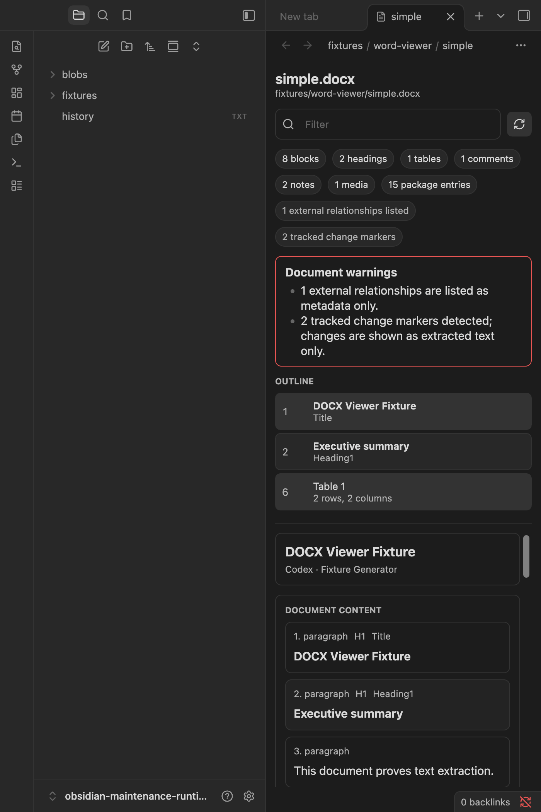
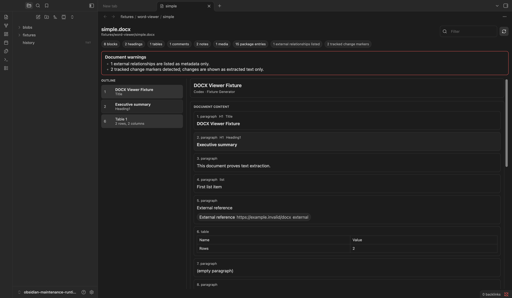

# Obsidian 1.15.1 verification — 16 November 2026

Maintenance patch `0.1.3` repairs outline button height and narrow header/summary overlap. Actual Obsidian 1.15.1 exercised final CSS candidate `18ced6968df79672b1f1656728cd19fdccf36b2f` with exact source, bundle, manifest and CSS hashes. Production main.js SHA-256: `47cc67d9d3dd4da7581ee73f2ad886559191db1f16a95825cb1c3dd633e43603`.

The earlier actual-host fixture run checked fixture-specific rendered values for `fixtures/word-viewer/simple.docx` and opened five further DOCX fixtures as smoke checks for nonempty output and no plugin-load failure. Every input hash was unchanged; primary values, extension/command unregistration and reload passed. Those other fixtures did not receive separate semantic malformed/encrypted/embedded-object oracles. Final CSS changes preserve the tested TypeScript, production bundle and manifest.

The outline height repair was checked with a native-height negative control that reproduced metadata overflow, then with automatic height containing all metadata and separating all three controls. Outline click/rerender and reload passed. A later independent image review found header/statistics overlap at an emulated 700px application viewport; that evidence was retained and the header shrink repaired before publication.

Final tests at emulated application viewports of 700×1050 and 1800×1050 assert header/summary/warnings separation, toolbar containment within header in both axes, filter containment and positive filter/reload widths, and no filter/reload overlap. Restoring old flex-shrink reproduced the narrow header overlap. Outline metadata containment, selection of the second outline control, reload and unchanged original DOCX bytes passed with the final CSS.

Tests use fictional fixtures in an own synthetic vault on macOS arm64, actual Obsidian 1.15.1 and Electron 39.8.3. A bounded bootstrap separates the test profile and CLI socket. Mock keychain is enabled; ordinary CLI owner, socket inode and version response and original application bytes remained intact before/during/after. Own host and children were confirmed stopped. Windows may be visible and remain unfocused; no OS mouse/keyboard or native resize/throttle commands are used.

Locked install, TypeScript, production build, existing tests, official Obsidian lint and production audit passed. Generated test artifacts are outside the official production-source lint scope. This establishes the exercised macOS behavior, not native resizing, pane/container layouts, mobile, minimum-version, authentication or real keychain behavior. Official source/release scans, asset readback and fresh Community installation remain separate publication gates.

